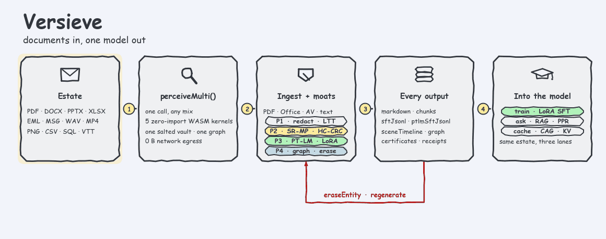
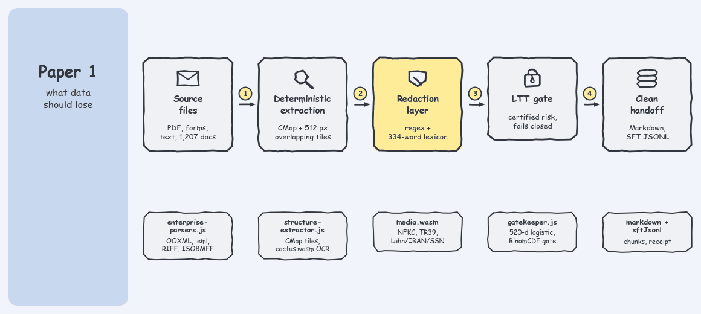
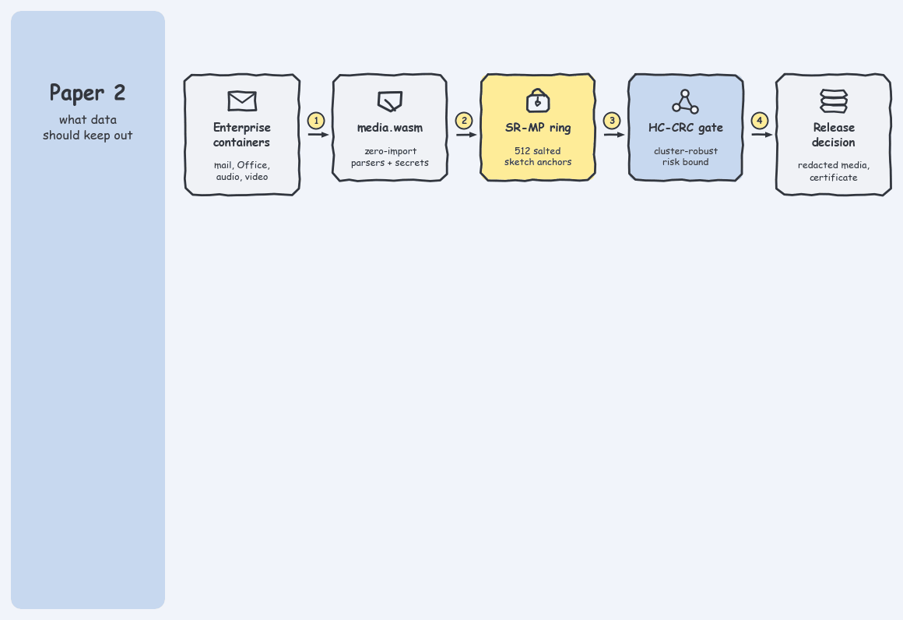
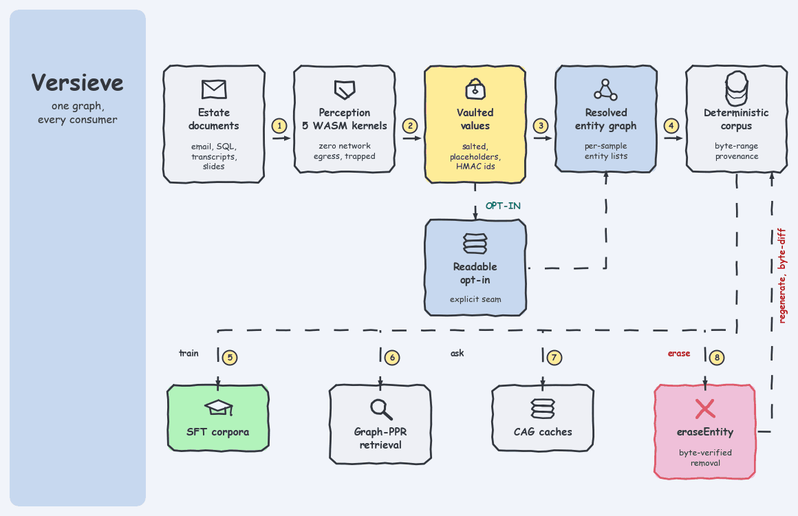

# Versieve

[](https://github.com/gegearsyah/versieve/actions/workflows/ci.yml) [](LICENSE) [-0f766e)](#1-the-five-zero-import-no_std-rustwasm-kernels-vendorwasm) [](https://www.rtio.io/sandbox)

**One-Shot Zero-Egress Multimodal Perception, Redaction & Tokenization for AI Training and RAG.**  
*Perceive documents, spreadsheets, presentations, images, emails, audio recordings, and video into structured, PII- and secret-redacted training tokens, synchronized omnimodal scene timelines, and knowledge graphs locally with zero user-byte egress: five zero-import WebAssembly kernels handle core parsing, redaction, and graphing, paired with optional local binaries and offline-cached weights for neural NER, OCR, and Node audio/video.*

**Zero egress, in one sentence.** No user document bytes, transcripts, or prompts leave the machine; optional model weights (`gliner-pii-edge`, `whisper`, OCR models) are fetched once and cached offline, and every neural or media path fails closed when local weights or binaries are absent.

**Out of the box vs. optional local runtimes.**
- **Works out of the box (zero-import WASM + pure JS/Node, no external binaries or model weights):** Native PDF (`/ToUnicode` CMap, `/ObjStm`, `TJ` kerning), `.docx`, `.pptx`, `.xlsx`, `.eml`, `.msg`, `.vtt`/`.srt`, `.har`, `.ipynb`, `.ics`, Slack JSON, `.zip`/`.tar.gz`, Stage 3A checksum-verified PII & 30+ secret scanning, Unicode anti-evasion, `SR-MP` 512-slot salted sketch ring, 128-bit Bloom+Soundex PPRL, Dual-CSR graph PPR & `blast_radius`, local SQL, VeRA/BitNet DL kernel, WAV PCM16 redaction, JPEG/PNG/MP4 metadata scrubbing, and LTT/`HC-CRC`/`E-LTT` conformal gatekeeping.
- **Requires local host tools or pre-cached weights (fails closed when missing):** Node.js audio/video demuxing and transcription (`ffmpeg`, `whisper.cpp` / `faster-whisper`); Stage 3B local ONNX neural PII (`gliner-pii-edge`, `63.5 MB` INT8); scanned-page OCR (`cactus.wasm` local OCR weights or browser `/ocr/*` Tesseract WASM); browser speech transcription (`whisper-tiny` `40.8 MB` `q8` cached in CacheStorage); and local GPU LoRA fine-tuning (Python/PyTorch).

**The premise.** A company's knowledge is scattered across drives, mailboxes, wikis, ticket queues, call recordings, and slide decks. Versieve takes all of it, perceives every format locally, resolves the people and organizations across documents into one entity graph, and emits corpora, retrieval indexes, and cache contexts built on that identity. The goal is a model that understands the whole company because the data under it was understood and connected before training started.

**End to end.** Twelve file types enter one `perceiveMulti()` call, each format runs its own parser, and the four moats all draw on the same resolved estate. The call returns the full output set, and those outputs plug into a model three ways: as LoRA training data (`sftJsonl`, `ptlmSftJsonl`), as Graph-PPR retrieval over the dual-CSR graph, and as CAG key-value cache prefill (`buildCagDossier`). `eraseEntity` regenerates the corpus and loops back with a byte-verified diff.



---

## 🚀 Use It Now

**In the browser, zero install.** Drop a PDF, `.docx`, `.pptx`, `.xlsx`, `.eml`, `.wav`, or `.mp4` into **[rtio.io/sandbox](https://www.rtio.io/sandbox)**. Everything runs locally in WebAssembly and Web Workers.

**In Node.js, one call.** Install straight from GitHub (the npm registry release is pending), then perceive a file, a mixed multimodal stack, or an entire folder:

```bash
npm install github:gegearsyah/versieve
```

```javascript
import { perceiveMulti } from 'versieve';

const estate = await perceiveMulti('./company-drive');
console.log(estate.markdown);   // redacted, reading-order Markdown
console.log(estate.sftJsonl);   // chat rows ready for LoRA SFT
```

`perceiveMulti(inputs, options?)` accepts, in any mix:

| Input | Example |
|---|---|
| File path | `'./contracts/msa.pdf'` |
| Folder path | `'./company-drive'`, walked recursively by default |
| Raw text | `'Dr. Elena Vance approved the budget.'` |
| Raw bytes | `Buffer`, `Uint8Array`, or `ArrayBuffer` |
| Named object | `{ name: 'decks/board.pptx', bytes: pptxBytes }` |
| Video frames | `{ name: 'demo.mp4', frames: [...] }` |

`perceive(input, options?)` is the single-item form and returns the same shape. You do not label text versus bytes. A string is a path only if it exists, otherwise it is ingested as literal text, so check the path before passing a folder. Unnamed bytes are typed from magic bytes (PDF, PNG, JPEG, WAV, Office/ZIP, TAR, GZIP) and named `inline.<ext>`.

Common `options`:

| Option | Example | Effect |
|---|---|---|
| `recursive` | `false` | Read only the top level of a folder (default `true`) |
| `whitelist` | `['john.doe@example.com']` or `'./allow.txt'` | Never redact matching values; stays domain-scoped when an email includes a domain |
| `blacklist` | `'Project Nebula, Qwzzv'` or `'./deny.txt'` | Always redact matching values (wins over `whitelist` on overlap) |
| `keywords` | `['Elena Vance', 'AMBER']` or `'./topics.txt'` | Scope outputs (`markdown`, `chunks`, SFT, `graph`) to matching blocks after full-estate redaction |

`whitelist`, `blacklist`, and `keywords` each accept an array, a comma/newline-separated string, or a `.txt` file path (one term per line). Matching is deterministic with structural breakdown (emails, names, and handles match both ways: `elena.vance@acme.com` ↔ `Elena Vance` ↔ `@elena_vance`, plus honorifics, separator variants `ORG-2271` ↔ `ORG 2271`, diacritics, and digit-normalized phone numbers) without fuzzy guessing.

```javascript
const scoped = await perceiveMulti('./company-drive', {
  whitelist: ['public.contact@acme.com'],
  blacklist: './deny.txt',
  keywords: ['Elena Vance', 'AMBER'],
});
console.log(scoped.redactedValues); // [{ value, token, type, category }, ...]
```

**Advanced `perceiveMulti` options.** Everything below is local, and defaults stay out of the box:

| Option | Example | Effect |
|---|---|---|
| `detectors` | Adapters built with `createDetectorAdapter` | Plugs external text and image detectors into the same estate: local Presidio, GLiNER-Edge (`63.5 MB` INT8), ONNX Stage 3B; missing components fail closed |
| `shadowAudit` | `true` | Re-runs the active Stage 3A detectors over the redacted output and attaches a residual-leakage report to the receipt (`throwOnResidual` fails the call loudly) |
| `numGuard` | `true` | `verifyNumericIntegrity` checksums the numerics that survive redaction so no digit is silently mutated |
| HIPAA Safe Harbor validators | `{ hipaaPack: true }` (default on) | Checksum-verified `NPI`, `DEA`, `MBI`, `CLIA`, MRN, and date validators feed Stage 3A |
| `createReversibleVault` / `restoreFromVault` | Opt-in | The default salted vault is one-way irreversible; the opt-in reversible vault adds structured restoration that fails closed on errors |
| `includeMerkleRoot` | `true` | Adds an entity-sorted Merkle root and per-entity Merkle proofs to the corpus receipt, with zero drift to the base `corpusSha256` digest |

`exportTrainingDataset(perceived, { format })` writes the training files the estate already implies, in any of `llama-factory-sharegpt`, `llama-factory-alpaca`, `unsloth`, `oumi`, `nemo`, `document-qa`, and `ib-ptlm` (see What Comes Out).

Every input in one call shares a single GC-CRC anchor pool and entity graph, so a noisy later mention resolves to the same `<PII:PERSON_1>`:

```javascript
const workspace = await perceiveMulti([
  { name: 'mail/deal.eml', text: 'From: elena.vance@acme.com\n\nDr. Elena Vance approved the budget.' },
  { name: 'decks/board.pptx', bytes: pptxBytes },
  { name: 'calls/standup.vtt', text: 'WEBVTT\n\n00:00:10.000 --> 00:00:15.000\n<v Speaker>Elena Vans reviewed the deck.\n' },
]);

// "Elena Vans" in the transcript links back to "Elena Vance" in the email.
console.log(workspace.markdown);
```

Each call returns `perceptionStream` (`<DOC><BLOCK>` structure), `markdown`, `chunks`, `redactedValues`, `sftJsonl`, `ptlmSftJsonl`, `graph`, and `receipt`. The section below, What Comes Out, shows how to consume them.

**MCP server, 18 tools.** Clone the repo, run `npm install`, then `npm run mcp` starts a stdio JSON-RPC server. Register it in your MCP client:

```json
{
  "mcpServers": {
    "versieve": {
      "command": "node",
      "args": ["/absolute/path/to/versieve/src/mcp-server.js"]
    }
  }
}
```

**Claude Code skill.** The bundled local clean, gate calibration, and LoRA workflow installs by copying one folder:

```bash
cp -r skills/versieve-local-train ~/.claude/skills/
```

**CLI.** In a project that installed the package:

```bash
npx versieve audit-wasm
npx versieve ingest --input ./scanned-document.pdf --out ./results/ingest.json
npx versieve sanitize report.pdf --diff-report diff.json
npx versieve footprint
```

From a clone, use `node bin/versieve.mjs` with the same arguments. `audit-wasm` verifies at load time that all five WebAssembly kernels have zero host imports (`imports.length === 0`), so the kernels themselves have no network or filesystem surface (host runtimes, local binaries, and cached weights sit outside the WASM boundary and fail closed when absent). `sanitize` redacts one local file with zero network egress and writes the redacted copy plus a per-value redaction diff report (`--diff-report diff.json`) you can archive next to the receipt. `footprint` prints the local install surface (WASM kernel sizes, export counts, and the load-time import census) and exits nonzero if any kernel carries host imports.

---

## 🔥 Highlights

**In plain language:** Pass a folder of mixed enterprise files into one local call. Versieve parses hidden channels (notes, revisions, hidden sheets, email streams, audio/video metadata), catches follow-up or misspelled mentions of a person across documents without keeping plaintext names in memory, and gates every chunk before release: **`KEEP` (`allow`)** releases only when calibration supports the risk budget, **`ABSTAIN` (`redact` / human review)** holds uncertain chunks back for inspection, and **`DROP` (`deny`)** quarantines blocked or secret-bearing chunks. The statistical details below explain how each layer is calibrated and measured.

- **One-Shot Omnimodal Perception (`perceive` & `perceiveMulti`):** Rather than stitching together separate tools for PDFs, Office files, images, emails, audio calls, and screen-recorded videos, Versieve perceives heterogeneous files in a single pass, emitting structured layout/modality blocks (`<DOC><BLOCK...>`), a unified cross-modal **`sceneTimeline`**, clean Markdown, tokenized SFT/LoRA JSONL with **`PT-LM` (Privacy-Token Loss Masking)** metadata (`ptlmSftJsonl`), and a live Dual-CSR knowledge graph.
- **Pillar 1: Hierarchical Cluster-Robust Conformal Risk Control (`HC-CRC`) & Streaming Conformal Martingales (`E-LTT`):** Paragraph-level non-conformity scores within multi-page legal or clinical documents violate IID exchangeability ($\mathrm{ICC} = 0.1276$, cluster design effect $\mathrm{DEFF} = 2.62$ on `TAB` ECHR court rulings, causing naive paragraph-IID LTT to overshoot $\alpha = 0.10$ at `10.10%` FPR). `HC-CRC` (`src/gatekeeper.js`) corrects the cluster design effect with a conservative Kish-style adjustment, holding held-out FPR below budget at every operating point (`0.18% <= 1%`, `0.92% <= 2%`, `2.53% <= 5%`, `8.19% <= 10%`, `12.57% <= 15%`, `15.77% <= 20%`), while `E-LTT` Ville supermartingales ($E_t \ge 1/\delta = 20$) certify streaming calibration anytime-validly.
- **Pillar 2: `SR-MP` (Sparse-Reference Multimodal Perception) 512-Slot Salted Reference Sketch Ring in Zero-Import WASM:** Traditional redactors (Microsoft Presidio, vanilla GLiNER) score each chunk in isolation, missing unprefixed surnames in later paragraphs or homophone/OCR drift (`"Elena Vans"`, `"Pentikalnen"`) in audio and video slides. `versieve_media.wasm` implements a fixed-capacity `512`-slot (`16 KB`, $O(1)$ space) Salted Reference Sketch Ring (`vs_media_srmp_reset`, `vs_media_srmp_seed_anchor`, `vs_media_srmp_query_candidate`) storing only `128`-bit salted Bloom+Soundex sketches (`0` plaintext bytes). Across real `TAB` ECHR court rulings, `WASM SR-MP` lifts GLiNER-Edge Person recall from `85.39% -> 88.41%` ($\tau=0.50$) and high-precision Person F1 from `27.88% -> 40.78%` ($\tau=0.70$); on real 25-call `faster-whisper` audio (`n=97` planted PII tokens), `WASM SR-MP` cuts cross-model `small.en` attacker leakage from `94.85%` (raw) and `20.62%` (isolated Spoken ITN + GLiNER) down to **`8.25%` (`8/97`, `21/25` zero-leak calls)** at `100.0%` non-PII speech context retention.
- **Pillar 3: `PT-LM` (Privacy-Token Loss Masking) for Local LoRA Fine-Tuning:** Standard SFT on sanitized text leaves small models (`0.5B–1.7B`) dominated by high-surprisal `<PII:...>` placeholder tokens, which we call **placeholder-token gradient domination**: `40%–85%` of seen-document answers echo tags and `20%–47.5%` of in-scope held-out questions are falsely refused. `PT-LM` (`computePtlmMaskedSpans` in `src/perceive.js`) sets `labels[t] = -100` on placeholder spans and substitutes grammatical-role surrogates in the forward context, cutting tag emission to `0/210` and false refusals to `0.0%`, with seen-document token F1 `+0.194` / `+0.087` / `+0.117`. The effect is attributed to the masking-plus-substitution bundle, not to masking alone, and `Qwen2.5-1.5B` `PT-LM` seen F1 (`0.190`) remains below the untrained base (`0.202`).
- **Auditable Binary-Level Zero Egress (`imports.length === 0`):** Powered by five standalone `#![no_std]` Rust→WebAssembly kernels (`388,797 B` combined) compiled with **zero host imports**. A WASM module with zero imports has no network, filesystem, or OS syscalls; it can only read and write the memory slice passed to it. Optional host binaries (`ffmpeg`, `whisper`) and offline-cached neural weights (`gliner-pii-edge`, OCR) sit outside this WASM boundary and fail closed when absent.
- **Forensic Hidden-Channel Extraction:** Automatically extracts and audits hidden leak vectors that standard text parsers ignore: PowerPoint speaker notes & hidden slides, Excel `veryHidden` sheets, cell comments & `pivotCache` records, Word `<w:delText>` tracked deletions, Outlook `.msg` CFBF/OLE2 streams, HAR credentials, K8s Base64 Secrets, RIFF WAV chunks, and $O(1)$ MP4 `udta`/`meta` atoms.
- **Live Browser Sandbox ([rtio.io/sandbox](https://www.rtio.io/sandbox)):** Run the browser pipeline client-side in your browser tab, including off-thread ONNX Runtime Web proxy Worker speech transcription (`whisper-tiny` `40.8 MB` `q8`, 99 languages, cached in CacheStorage) with DSP Voice Activity Detection across 30s windows, 1080p dark-mode contrast-inverted keyframe slide OCR, and interactive `.wav`/`.mp4`/`.png` redaction studio.

---

## 🆕 What Is New: Training Data That Knows What It Describes

Document-to-training-data pipelines chunk by position and the chunk inherits meaning from where it sits. Versieve replaces that substrate with a resolved entity graph, and four properties follow that positional chunking does not have:

1. **One graph, every consumer.** The per-block, composed, and identity-pair training corpora, Graph-PPR retrieval (RAG), and CAG key-value cache prefill all traverse the same resolved entity graph: identity is resolved once, and every consumer inherits it. By contrast, `GraphGen` synthesizes new QA pairs from an extracted graph, `CuratorKIT` tracks append-only provenance chains without entity erasure, IBM `Docling` and `Unstructured` parse formats without an entity-indexed training graph, and in-context pretraining reorders documents by retrieval similarity; Versieve grounds the actual source bytes of multiple heterogeneous formats in one resolved identity graph with per-sample provenance.
2. **Erasure as a byte-verified property of the data.** `eraseEntity` regenerates the corpus minus one entity, and the diff receipt fails loudly unless the byte-diff is exactly that entity's spans. Prior machine unlearning spans sharded retraining (`SISA`), approximate parameter updates (`TOFU`), and zk-SNARK / hash-chain cryptographic verifiable unlearning (Eisenhofer et al., 2022; Maheri et al., 2025), while ICML 2025 evidence shows parameter-level unlearning is reversible (Xu et al., 2025). Versieve targets lightweight deterministic corpus-side exact regeneration with byte-diff receipts, paired with a sealed adapter retrain recipe.
3. **Binary-level zero egress for core kernels, receipted per run.** Five standalone `#![no_std]` Rust→WASM kernels (`388,797 B` combined) pass load-time `imports.length === 0` checks, trap-armed network surfaces, and a `0 B` egress receipt for every build; optional host binaries (`ffmpeg`, `whisper`) and offline-cached neural weights (`gliner-pii-edge`, OCR) are explicitly separated and fail closed when absent.
4. **Per-sample conformal certificates with transparent policy mapping.** Learn-Then-Test, `HC-CRC`, and `E-LTT` gatekeeping bound release risk relative to the scanner-derived labels (detector-closed and stated as such), mapping verdicts cleanly onto standard policy actions:

| Versieve Gate Verdict | Short Code | Policy Action | Meaning |
|---|---|---|---|
| `KEEP_SAFE` / `KEEP_SAFE_REDACTED` | `KEEP` | `allow` | Certified under the active risk budget; released to downstream training or retrieval |
| `ABSTAIN_HUMAN_REVIEW` | `ABSTAIN` | `redact` / review | Insufficient calibration support or intermediate risk score; held for redaction review |
| `DROP_OR_QUARANTINE` | `DROP` | `deny` | Blocked by risk floor, secret quarantine, or topic policy; never released |

### Why Not Stitch It Yourself?

A DIY local pipeline (separate PDF/Office parsers + Presidio/GLiNER + `detect-secrets`/Gitleaks + forensic inspector + Python/DuckDB glue) can match or beat Versieve on individual standalone detector F1, notably Microsoft Presidio on TAB (`79.26%` vs. `45.91%`). The trade-off is runtime footprint, cold start, audit boundary, and cross-format coordination:

| Dimension | Versieve (`perceiveMulti`) | Stitched Local Stack / Comparator |
|---|---|---|
| **Core kernel footprint** | **5 zero-import WASM kernels (`388,797 B` combined)** | Multi-package Python/C++/Go installs (`~401 MB` for Presidio `en_core_web_lg` alone) |
| **Cold process startup & RSS (Paper 1, 7-trial median)** | **C99: `14.12 ms` / `6.08 MB` RSS**; **Node+WASM: `106.22 ms` (`1.045 ms` WASM init) / `55.97 MB` RSS** | **`PyTorch+DuckDB` (NOT Presidio):** `12,917.14 ms` (`12.9 s`) / `432.3 MB` RSS; Python+NumPy: `388.79 ms` / `31.49 MB` RSS |
| **Raw TAB NER speed & F1 (Paper 2)** | `versieve_media.wasm` Stage 3A `0.29 ms/doc` (`46.66%` F1); GLiNER-Edge `510.74 ms/doc` (`41.49%` vanilla, `44.23%` dev-filtered) | **Microsoft Presidio (`en_core_web_lg`, `400.7 MB`)** steady-state `30.67 ms/doc`, **`79.26%` F1** (intended to plug underneath Versieve's gate) |
| **Load-time capability audit** | `imports.length === 0` across all 5 WASM kernels (`audit-wasm`) | Policy-only local execution across host runtimes |
| **Cross-modal identity, gating & erasure** | Single call emits shared entity graph, conformal gate (`allow`/`redact`/`deny`), and `eraseEntity` byte-diff receipt | Separate tools with custom glue; no shared entity graph, finite-sample abstention, or byte-diff erasure receipt |

**Measured, not estimated (`results/ease-benchmark.json`).** Same host (AMD Ryzen 7 7840HS, Windows 11, 5-run medians):

| Dimension | Versieve (`perceive`) | Stitched Python stack (Presidio + spaCy `en_core_web_lg` + detect-secrets) |
|---|---|---|
| **On-disk footprint** | **`1.49 MB` total (`388,797 B` WASM + `1,170,401 B` JS)** | `518.86 MB` (`348.9x` larger) |
| **External runtimes required** | **`1` (Node.js)** | `4` |
| **Lines of code to receipted redaction** | **`3 LOC`** | `26 LOC` |
| **Cold-start median (5 runs)** | **`115.67 ms`** | `14,745.83 ms` (`127.48x` slower) |

Forensics land on the same numbers measured against the competitor tools (`results/competitor-benchmarks.json`): `27/27` Unmasker specimen categories covered, `7/7` MAT2 formats with `0` residual metadata bytes, and on the screenleak specimen suite `91.67%` text zero-leak (`11/12` PII-bearing specimens) and `87.50%` image zero-leak at `IoU >= 0.30` (`7/8` frames). The single missed image frame holds a non-textual face/avatar region, which the built-in blind OCR text channel does not detect without a plugged visual detector.

Every number in the four papers in `paper/` is verified through the CI check chain (`node scripts/check-paper-numbers.mjs`, `0` failures); the round-1 panel review and revision response are in `docs/review/paper4-round1/`.

---

## 🏛️ The Moat, Paper by Paper

Each paper defends one mechanism. The comparison below is the one a buyer would run: the same product with the mechanism removed, or the strongest external baseline on the same data.

| Paper | Mechanism | What you get without it | Measured difference | What the mechanism does not claim |
|---|---|---|---|---|
| **1 · Extraction** | Deterministic local extraction and a fail-closed LTT gate | Raster OCR, cloud preprocessing, or a threshold with no certified risk | `8/8` PMC PDFs at `209.02 ms`; `97.38%` FUNSD box survival; LTT `14.63% → 0.0%` conditional FPR; C99 startup `14.12 ms` vs `12,917 ms` for PyTorch+DuckDB | The certificate is detector-closed: it bounds what the scanner-derived labels can catch, not independent PII truth |
| **2 · Multimodal** | `SR-MP` cross-paragraph ring inside the zero-import media kernel, plus `HC-CRC` | Isolated per-paragraph GLiNER-Edge; naive paragraph-i.i.d. LTT | Person recall `85.39% → 88.41%` at `τ=0.50`; high-precision Person F1 `27.88% → 40.78%` at `τ=0.70`; audio attacker leakage `20.62% → 8.25%`; gate overshoot `10.10% → 8.19%` at `α=10%` | Presidio with the same ECHR regex still wins overall F1 (`79.26%` vs `45.91%`); on audio, plain Jaro-Winkler on the same anchors reaches `7.22%` leakage, so the ring's measured advantage is anchor privacy, not matching accuracy |
| **3 · Training** | `PT-LM` for redacted fine-tuning, and Graph-PPR retrieval as the stronger default | Standard SFT on redacted text; or closed-book LoRA with no retrieval | Tag hallucination `40%–85% → 0%`; false refusal `20%–47.5% → 0%`; seen-doc F1 `+0.194` / `+0.087` / `+0.117`; Graph-PPR beats every closed-book LoRA arm on held-out QA (`p=0.0005` on F1), at lower latency | The PT-LM effect is attributed to the masking-plus-surrogate bundle (masking-only ablation not yet run); canaries use scanner-detectable formats; `Qwen2.5-1.5B` `PT-LM` seen F1 (`0.190`) remains below untrained base (`0.202`). At this scale the moat is retrieval, not training |
| **4 · Corpus** | Entity-indexed corpus with byte-verified erasure and graph routing | Positional chunking: no shared identity, no byte provenance, no exact removal | Graph-PPR `53.3%` exact (`83.3%` cross-document); `eraseEntity` regenerates the corpus with a byte-diff of exactly one entity's spans; a wrong merge amplifies by `14.32x` | Trained formats do not separate: composed `11.7%` vs per-block `10.0%` (McNemar `p=1.00`). BM25 answers `60.0%`, numerically above Graph-PPR. The `81.7%` routing figure is an upper bound given a correctly resolved identity |

### `SR-MP`, concretely

`SR-MP` is a fixed `512`-slot ring (`16 KB`) of `128`-bit salted Bloom+Soundex sketches inside `versieve_media.wasm`. High-confidence detections in opening paragraphs seed the ring. A later bare surname, an OCR substitution, or an ASR homophone is scored against every sketch, and a match above the coupling threshold maps the mention to the same vaulted entity id. The ring stores no plaintext, so it survives redaction and stays inside the zero-import kernel.

The comparison is against the same detector with the ring removed:

| Condition | Person recall `τ=0.50` | Person F1 `τ=0.50` | Person F1 `τ=0.70` | Audio leakage |
|---|---:|---:|---:|---:|
| Isolated Dev-Filtered GLiNER-Edge | `85.39%` | `74.20%` | `27.88%` | `20.62%` |
| GLiNER-Edge + `SR-MP` ring | `88.41%` | `73.27%` | `40.78%` | `8.25%` |

Three boundaries belong next to those numbers. At `τ=0.50` the ring trades `0.93` F1 for `3.02` points of recall and sits slightly below Dev-Filtered GLiNER (`p=0.0448`); at `τ=0.70` it gains `12.90` F1 (`p=0.0002`). A dumb baseline that propagates every detected name to later same-document mentions reaches `61.07%` F1, and the ring beats it at both operating points (`p=0.0002`). On audio, plain Jaro-Winkler on the same anchor list reaches `7.22%` leakage, slightly better than the ring's `8.25%`; the ring's measured contribution there is that the anchor list stays salted and out of plaintext.

---

## 🗺️ Architecture, One GIF per Paper

Each animation follows the path its paper measures, including the branches. Boxes are mechanisms, numbered badges are order, dashed arrows are data flow, colour-coded labels mark decisions (`YES`/`NO`, `OPT-IN`, `train`/`ask`/`erase`), and boxes below the main row are the side paths (OCR fallback, abstention, a refused answer that retries retrieval, the next container in a stream, the readable-identity seam, an erasure regeneration). The cards under each stage name the module or function that actually runs there. All four share the same hand-drawn register and run as a seamless dash-march loop.

**Paper 1: what data should lose.** Source files become deterministic extraction, regex and lexicon redaction, an LTT gate that fails closed, and a clean training handoff.



**Paper 2: what data should keep out.** Enterprise containers enter the zero-import media kernel, `SR-MP` couples cross-paragraph and cross-modal mentions, `HC-CRC` bounds release risk, and the decision carries a certificate.



**Paper 3: what data should carry.** The redacted corpus either goes through `PT-LM` and LoRA SFT to the blind judges, or skips training entirely and answers through Graph-PPR retrieval.


**Paper 4: how data should look.** Estate documents become vaulted values and a resolved entity graph, with readable identity only as an explicit opt-in branch. The deterministic corpus then feeds four consumers in three lanes, `train`, `ask`, and `erase`, and `eraseEntity` loops back into the corpus as a byte-verified regeneration.



---

## 🧠 Core Concept: What is `GC-CRC`?

In traditional de-identification and document parsing pipelines, every text chunk, slide, or 30-second audio transcript turn is evaluated **independently**, scoring only its own local confidence $s_{\text{local}}(m)$:

1. **The Fragmented Context Horizon:** An entity introduced with explicit context on Page 1 of a legal ruling or in an email (*"Applicant: Mr. Markus Pentikäinen, case 11882/10"*) reappears 40 paragraphs later (or in a noisy Whisper ASR audio turn *"markus pentikaynen"* or dark-mode video slide *"Pentikalnen"*) without its title prefix or with character/phonetic drift. An isolated detector assigns a low score $s_{\text{local}}(m) < \tau$ and leaks the identity.
2. **Low-Threshold Precision Collapse:** Lowering a neural detector's global threshold from $\tau=0.60$ to $\tau=0.20$ to catch bare or noisy mentions causes false positives on domain-specific capitalized phrases (*"Clinical Trial"*, *"Confidence Interval"*, *"the High Court"*) to spike by $+140\%$.

**Versieve introduces Graph-Coupled Cross-Modal Conformal Redaction (`GC-CRC`, `src/perceive.js`)** to decouple cross-modal recall from local threshold lowering:

1. **Bounded Salted Reference Anchor Pool ($|A| \le 512$):** High-precision spans ($s_{\text{local}} \ge \tau_{\text{anchor}}$ or checksum-verified Stage 3A identifiers) populate a fixed-size working pool of reference anchors $A = \{(e_k, \text{sig}_k, v_k)\}$, storing only their 128-bit salted Bloom+Soundex signature $\text{sig}_k \in \{0,1\}^{128}$ (`vs_media_pprl_signature` in `versieve_media.wasm`) and Dual-CSR graph node $v_k$ (`versieve_graph.wasm`).
2. **Cross-Modal Graph-Phonetic Risk Propagation:** Candidate tokens $m$ in block $c$ across any modality (later paragraphs, audio ASR turns, video OCR keyframes) receive a coupled score:

   $S_{\text{GC}}(m, c) = 1 - \bigl(1 - s_{\text{local}}(m)\bigr)\bigl(1 - \gamma \max_{a \in A} \mathrm{Sim}(\text{sig}(m), \text{sig}(a))(1 + \beta d_{a,c}^{-1})\bigr)$

   Weak or noisy mentions that couple phonetically or lexically with an established reference anchor are promoted above $\tau_{\text{anchor}}$ and mapped to the **exact same `<PII:PERSON_k>` entity ID**, while uncoupled domain phrases remain untouched (`0` extra false positives).
3. **Finite-Sample LTT Conformal Certification:** Block-level coupled non-conformity scores feed a Learn-Then-Test (LTT) binomial gatekeeper that certifies when $\mathrm{BinomCDF}(k_j; n_{\text{cal}}, \alpha) \le \delta$, bounding corpus-level false-release risk at $\le \alpha$ with explicit abstention when calibration support is insufficient.

---

## 📐 Structured Perception Output & Post-Processing

Like modern long-horizon perception engines that emit structured layout blocks before rendering Markdown or training records, Versieve natively produces a **Structured Multimodal Perception Stream** alongside ready-to-train outputs:

```xml
<DOC src="mail/deal.eml">
  <BLOCK id="b1" modality="email" role="EMAIL_HEADER" gate="KEEP_SAFE_REDACTED" risk="0.920" entities="[ent_email_41c9]">From: <PII:EMAIL_1> | Subject: Q4 Rollout</BLOCK>
  <BLOCK id="b2" modality="email" role="EMAIL_BODY" gate="KEEP_SAFE_REDACTED" risk="0.930" entities="[ent_person_8f2a]">Lead counsel Dr. <PII:PERSON_1> signed off on the audit.</BLOCK>
</DOC>
<DOC src="calls/standup.vtt">
  <BLOCK id="b3" modality="audio" role="TRANSCRIPT_TURN" gate="KEEP_SAFE_REDACTED" risk="0.884" time="[10000,15000]" entities="[ent_person_8f2a]"><PII:PERSON_1> reviewed the deck and confirmed deployment.</BLOCK>
</DOC>
```

From a single `perceive()` or `perceiveMulti()` call, Versieve returns:
- **`perceptionStream`**: Coordinate-, time-, and entity-anchored `<DOC><BLOCK...>` stream across all modalities.
- **`markdown`**: Clean, reading-order redacted Markdown ready for RAG indexing.
- **`chunks` & `sftJsonl`**: Token-windowed (`versieve_clean.wasm`), SimHash-deduplicated chunks and chat-formatted SFT JSONL rows ready for LoRA fine-tuning.
- **`graph`**: Live Dual-CSR `versieve_graph.wasm` instance supporting `<1 ms` Personalized PageRank (`pprRetrieve`) and GDPR Art. 17 right-to-be-forgotten erasure (`blastRadius`).
- **`receipt`**: Cryptographic SHA-256 provenance receipt (`versieve-gccrc-v1`).

---

## 📦 What Comes Out, and How You Train on It

`perceive()` and `perceiveMulti()` return more than chunks. Each call returns `perceptionStream` (a `<DOC><BLOCK>` text stream that keeps document structure), `markdown`, `chunks`, `sftJsonl`, `ptlmSftJsonl`, `graph`, and `receipt`. The JSONL is an ordinary chat file, the graph is a by-product you can ignore, and consuming any output is optional.

### The JSONL is an ordinary chat file

Each line is one sample with a system prompt, a user prompt naming the source, and the redacted chunk as the assistant answer:

```json
{"id":"contracts/msa.pdf#3","source":"contracts/msa.pdf","modality":"document",
 "messages":[
  {"role":"system","content":"Answer strictly from the provided sanitized context."},
  {"role":"user","content":"Summarize the key record from contracts/msa.pdf (body)."},
  {"role":"assistant","content":"The agreement renews on 2027-03-01. <PII:PERSON_1> signs for the vendor."}]}
```

`ptlmSftJsonl` adds `ptlm_mask_spans`, `ptlm_placeholder_count`, and `ptlm_unmasked_ratio` to the same row. Those spans mark where a secret was replaced by a placeholder.

### Training is a small LoRA run, not a pipeline to build

Feed either file to any SFT trainer. The recipe this repository measures is in `scripts/run-track-d-fair-lora.py`: a PEFT `LoraConfig`, assistant-only loss (prompt tokens are labeled `-100` so the model is graded only on the answer), 80 steps, seed 42, on `Qwen2.5-0.5B/1.5B` and `LFM3-1.7B`, inside 8 GB of GPU memory. The PT-LM arm also masks placeholder subwords out of the loss and forward-substitutes a same-length surrogate, so the model learns the identity slot without ever learning the value that filled it.

Nothing about that needs the graph. The graph stays separate from training.

`exportTrainingDataset(perceived, { format })` reshapes the same records into the trainer dialect you already run: `llama-factory-sharegpt`, `llama-factory-alpaca`, `unsloth`, `oumi`, `nemo`, `document-qa` (question-answer supervision over the estate's documents), and `ib-ptlm` (paired counterfactual surrogate views for the IB-PT-LM trainer).

### Three ways to consume the same data

| Path | What it is | When to use it |
|---|---|---|
| **LoRA SFT** | Train on `sftJsonl` or `ptlmSftJsonl`. | The knowledge must live in the weights (offline, single model, no retrieval). |
| **Graph-PPR retrieval** | Keep documents on disk, build the entity graph, and answer with `pprRetrieve` contexts at question time. | The knowledge changes, must be attributable to a source, or must be erasable. |
| **CAG cache prefill** | Prefill a fixed KV cache from per-entity records, then append only the question. | The question population is small and stable and prefill cost must be amortized. |

### The honest part

Paper 4 measured all three on a 115-document noisy estate with 60 questions, one 1.5B model, and a 25,755-token budget. The trained formats did not separate: composed samples reached 11.7% exact match and per-block chunks 10.0% (McNemar p=1.00), against a base of 1.7%. Graph-PPR retrieval with no fine-tuning answered 53.3%, and a plain BM25 control 60.0%, numerically above the graph and within noise at n=60. So the measured win is retrieval, provenance, and byte-verified erasure, not fine-tuning. Train when the model must carry the knowledge itself; retrieve when it can look it up.

---

## 📚 Research Papers (Included in `paper/`)

All four MLSys-formatted benchmark papers, along with their LaTeX sources, BibTeX references, vector figure builders (`paper/figs/`), and raw JSON benchmark outputs (`results/`), are checked into this repository:

1. **[Paper 1: What Training Data Should Lose: Local Extraction, Redaction, and Fail-Closed Gatekeeping](paper/versieve-extraction-redaction-benchmark.pdf)** ([`.tex`](paper/versieve-extraction-redaction-benchmark.tex))  
   *Evaluates native PDF CMap/kerning extraction, 2D overlapping tiling on 199 ICDAR-2019 FUNSD forms (`30,595` word boxes), deterministic PII disambiguation across `ai4privacy-200k` and `PubMedQA`, finite-sample LTT conformal calibration, and 7-trial interleaved runtime substrates (`C99` vs. `Node+WASM` vs. `Python+NumPy` vs. `PyTorch+DuckDB`).*
2. **[Paper 2: What Training Data Should Keep Out: Multimodal Sanitization and Fail-Closed Release](paper/versieve-multimodal-sanitization-benchmark.pdf)** ([`.tex`](paper/versieve-multimodal-sanitization-benchmark.tex))  
   *Evaluates the `204,031 B` zero-import `versieve_media.wasm`, `SR-MP` anchor coupling, Stage 3B `gliner-pii-edge`, and `HC-CRC` / `E-LTT` against external tools and human-annotated corpora: the Text Anonymization Benchmark (`TAB`, `N=1,268` ECHR court rulings) vs. Microsoft Presidio (`en_core_web_lg` + custom recognizers), non-circular ground-truth LTT across three gate architectures, enterprise secrets vs. `Gitleaks v8.30.1` and Yelp `detect-secrets v1.5.0`, Unicode anti-evasion vs. Python `NFKC`, end-to-end TTS→Whisper (`base.en` / `small.en`) audio waveform redaction, 128-bit salted Bloom+Soundex PPRL across `124,750` candidate pairs, cross-modal GDPR Art. 17 erasure, and `O(1)` multi-GB MP4 container scrubbing.*
3. **[Paper 3: What Training Data Should Carry: Local Fine-Tuning, Loss Masking, and the Retrieval That Beats It](paper/versieve-local-training-benchmark.pdf)** ([`.tex`](paper/versieve-local-training-benchmark.tex))  
   *Evaluates three fine-tuned models on an 8 GB RTX 4070 Laptop GPU (`Qwen2.5-0.5B-Instruct`, `Qwen2.5-1.5B-Instruct`, `LFM3-1.7B-Base` trained as matched Raw vs. Versieve-Safe assistant-only `T2-Chat` LoRA pairs) plus three quantized Ollama comparators (`lfm3:latest`, `llama3.2:3b`, `qwen2.5:7b`): Carlini `20×`-canary weight exposure, adversarial context extraction, blinded local `qwen2.5:7b` and cross-family `llama3.2:3b` judge grading, and the finding that zero-training Graph-PPR retrieval beats every closed-book LoRA arm at this scale.*
4. **[Paper 4: How Training Data Should Look: From Stitched Chunks to Records That Know What They Describe](paper/versieve-graph-grounded-enterprise-corpus.pdf)** ([`.tex`](paper/versieve-graph-grounded-enterprise-corpus.tex))  
   *Describes the entity-indexed training corpus built by the zero-egress pipeline (every detected value vaulted behind a salted placeholder and resolved onto a stable entity identifier, with per-sample provenance and conformal certificates), a ten-arm head-to-head across trained formats, question-time Graph-PPR retrieval, and CAG cache prefill on a synthetic noisy estate, and exact corpus regeneration minus one entity with byte-diff erasure receipts. The trained formats do not separate; the measured wins are retrieval, provenance, and erasure.*

---

## 🏗️ System Architecture: Zero-Import WASM Kernels & Runtime Layers

### 1. The Five Zero-Import `#![no_std]` Rust→WASM Kernels (`vendor/wasm/`)

Every kernel is compiled with `wasm32-unknown-unknown` (`panic = "abort"`, LTO enabled) and verified in CI (`npm run audit-wasm`) to have **`0` host imports**:

| Kernel Binary | Size | Imports | Source Crate | Exports | Verified Responsibilities |
|---|---:|---:|---|---:|---|
| **`versieve_clean.wasm`** | `14,633 B` | `0` | `rust/versieve-clean/` | `18` | HTML/script/style/comment stripping, UTF-8 entity decoding, 2,048-slot FNV-1a/SimHash deduplication ring with eviction accounting, and token-window chunking. |
| **`versieve_media.wasm`** | `204,031 B` | `0` | `rust/versieve-media/` | `29` | RFC 1951 DEFLATE/GZIP + ZIP/TAR (`100:1` bomb ratio & Zip-Slip guards), CFBF/OLE2 `.msg` stream extraction, NFKC + TR39 homoglyph + zero-width anti-evasion, checksum-verified PII (Luhn, IBAN mod-97, ABA, NPI, NHS, AU TFN, SSN) & 30+ secret scanner, 128-bit salted Bloom+Soundex PPRL (`vs_media_pprl_signature`), **`SR-MP` 512-slot (`16 KB`) Salted Reference Sketch Ring (`vs_media_srmp_reset`, `vs_media_srmp_seed_anchor`, `vs_media_srmp_query_candidate`)**, Spoken ITN (`vs_media_spoken_itn`), WAV PCM16 redaction (`silence`/`beep`/`noise` + RIFF metadata scrub), JPEG/PNG/MP4 metadata scrub (`udta`/`meta`/`EXIF`/`GPS`), 64-bin RGB scene-change delta, temporal box hold/interpolation, and RGB/RGBA pixel blackout/mosaic/Gaussian blur. |
| **`versieve_graph.wasm`** | `54,402 B` | `0` | `rust/versieve-graph/` | `27` | Dual-CSR forward/reverse knowledge graph (`65,536` nodes, `262,144` edges), HippoRAG-2 Personalized PageRank (`15` power iterations), $<1\,\text{ms}$ GDPR Art. 17 `blast_radius`, BFS shortest path, Tarjan SCC, Louvain clustering, and `.csr` binary snapshots. |
| **`versieve_dl.wasm`** | `60,096 B` | `0` | `rust/versieve-dl/` | `27` | 1.58-bit ternary BitNet quantization, VeRA adapter forward/backward updates (`mle_dl_vera_*`), and 64-dimensional needle retrieval embeddings. |
| **`versieve_sql.wasm`** | `55,635 B` | `0` | `rust/versieve-sql/` | `15` | Deterministic in-memory relational SQL subset engine (`MAX_ROWS = 4,096`). |
| **Combined Total (5 Kernels)** | **`388,797 B`** | **`0`** | `vendor/wasm/` | **`116`** | **Load-time `imports.length === 0` verified across all five binaries (`audit-wasm`).** |

### 2. RTIO Browser Sandbox ([rtio.io/sandbox](https://www.rtio.io/sandbox)) vs. Standalone Versieve CLI / MCP Server

Versieve runs the **exact same byte-identical WASM binaries** in the browser and in Node.js (enforced by CI parity tests), while adapting heavy media decoding to each runtime's memory boundaries:

| Capability | RTIO Browser Sandbox ([rtio.io/sandbox](https://www.rtio.io/sandbox)) | Versieve Node.js CLI & 18-Tool MCP Server |
|---|---|---|
| **Data Egress Guarantee** | **100% client-side in the browser tab** under `Cross-Origin-Embedder-Policy: require-corp`. User files never upload to any server. | **100% local offline execution.** Fails closed on missing local weights; SSRF-hardened URL fetch blocks private/loopback/IMDS CIDRs. |
| **Documents & Archives** | Native PDF (`/ToUnicode` CMap, `/ObjStm`, `TJ` kerning), bit-3 `.docx`, `.pptx` (speaker notes + hidden slides), `.xlsx` (veryHidden sheets + comments + pivotCache), `.eml`, `.msg`, `.vtt`/`.srt`, `.har`, `.ipynb`, `.ics`, Slack JSON, `.zip`/`.tar.gz`. | Identical WASM + JS parsers (`src/enterprise-parsers.js`, `src/pdf-parser.js`, `src/structure-extractor.js`). |
| **Stage 3A PII & Secrets** | Live in-browser `versieve_media.wasm` (`maskTextContextAware`) + `SaltedPseudonymVault` + forensic hidden-channel badges in `CleanTab`. | Identical `versieve_media.wasm` Stage 3A + optional Stage 3B local ONNX `gliner-pii-edge` (`63.5 MB` INT8, `src/neural-pii-onnx.js`) + `GC-CRC` anchor propagation (`src/perceive.js`). |
| **Audio & Video Transcription + Redaction** | Off-main-thread ONNX Runtime Web proxy Worker (`/ort/ort-wasm-simd-threaded.*.wasm`) running multilingual `whisper-tiny` (`40.8 MB` `q8`, 99 languages, cached in browser CacheStorage) over DSP VAD-selected 30s active speech windows (up to **30 min / ~350 MB** per browser tab WebAudio RAM limit) + Spoken ITN + timestamp-agnostic speech dedup + 1080p dark-mode contrast-inverted keyframe slide OCR (`/ocr/*` Tesseract WASM with readability filtering) + interactive `MediaRedactionStudio` (`.wav` mute/beep, `.mp4` `O(1)` `Blob.slice()` atom scrub, `.png`/`.jpg` bounding-box pixel blackout/blur). | **No browser tab RAM limit (supports 3-hour+ multi-GB recordings):** `O(1)` `4 KB` file-descriptor seeking (`inspectMp4StreamMetadata` / `scrubMp4FileMetadata`), streaming local `ffmpeg` demuxing (`src/video-redactor.js`), native local `whisper.cpp` / `faster-whisper` (`src/audio-redactor.js`), and sample-accurate WAV & keyframe pixel redaction via `versieve_media.wasm`. |
| **Retrieval & Training** | In-browser Dual-CSR `versieve_graph.wasm` PPR + lexical/cosine hybrid retrieval (`Chat`), in-browser `versieve_dl.wasm` VeRA adapter training (`Train`), and one-click sanitized SFT JSONL + LoRA script export. | Full `versieve_graph.wasm` indexing, Native KV-Cached CAG dossier builder (`src/cag-dossier.js`) with `<1 ms` GDPR Art. 17 KV-slot eviction, and local RTX GPU LoRA training/evaluation harness. |

### 3. Data Architecture: Documents → Resolved Graph → Every Consumer


The stack runs in four layers. Scattered estate documents (SQL, CSV, email, transcripts, audio, decks) enter the five zero-import WASM kernels with zero egress. Every detected value is vaulted behind a salted placeholder and derives a stable HMAC entity identifier, so one resolved entity graph carries per-sample provenance and conformal certificates. That graph is exported as deterministic corpus seams (per-block JSONL, composed per-entity records, identity-contrastive pairs) in a vaulted or readable view. The same graph then grounds four consumers with no identity rebuilt anywhere: LoRA SFT training, Graph-PPR retrieval (RAG), CAG key-value cache prefill (fixed set-cover or per-question identity-keyed), and `eraseEntity`, which regenerates the corpus minus one entity with a byte-diff receipt because the graph names exactly the spans an entity owns. Positional chunking gives none of these consumers an identity to share, which is why erasure, provenance, and cross-document grounding all ride on the graph.

---

## 📊 Empirical Benchmarks Across All Four Papers

Headline numbers here, one reading per paper, and the caveats that keep the claims honest. Every full table, confidence interval, and baseline-by-baseline comparison lives in the papers in `paper/`, and every figure below is verified in CI (`node scripts/check-paper-numbers.mjs`, `0` failures).

### 1. `GC-CRC` Cross-Modal Context Relay (`60` cases, `240` multimodal blocks, `results/gccrc-cross-modal-benchmark.json`)

Across linked ruling anchor, follow-up paragraph, ASR turn, and dark-slide OCR modalities, `GC-CRC` recovers `76.11%` of noisy cross-modal follow-ups at `75.18%` F1 with zero extra domain false positives; the isolated pipeline misses `100%` of those follow-ups at high precision, and dropping its threshold to reach `84.72%` recall costs `+140%` false positives (`75 -> 180`). Full table in [Paper 2](paper/versieve-multimodal-sanitization-benchmark.pdf).

### 2. Paper 1: Extraction and Fail-Closed Gatekeeping (`1,207` public docs, `npm run bench:scale`)

Scoped `/ToUnicode` CMap resolution and kerning reconstruction extract `8/8` PMC PDFs (`8,134` lines, `55,099` words) in `209.02 ms` total without raster OCR, and `512x512` 2D tiled chunking keeps `97.38%` of `30,595` FUNSD word boxes where untiled `512px` chunking keeps `20.53%`. On resources, C99 starts in `14.12 ms` / `6.08 MB` RSS against PyTorch+DuckDB at `12,917.14 ms` / `432.3 MB` RSS; NumPy still wins warm batched matrix ops once imported. Full curves in [Paper 1](paper/versieve-extraction-redaction-benchmark.pdf).

### 3. Paper 2: TAB ECHR, Secrets, and Audio (`127` held-out rulings)

On human-annotated TAB, the honest top line is Microsoft Presidio (`en_core_web_lg`, `401 MB`): `79.26%` F1 with the same ECHR regex, versus `45.91%` for the zero-import hybrid (which reaches `100.00%` DIRECT recall, and is the only arm measured under a zero-import runtime split). Latency from the same sweep: Stage 3A `0.29 ms/doc`, Presidio `30.67 ms/doc`, GLiNER-Edge `510.74 ms/doc`. The gate is the calibrated half of the paper: naive paragraph-IID LTT overshoots its `10.0%` risk budget (`10.10%` conditional FPR), while document-clustered `HC-CRC` holds `8.19%` at the same budget with `65.16%` safe yield, and streaming `E-LTT` stays anytime-valid (`HC-CRC` is a conservative design-effect adjustment, not a proven finite-sample guarantee). The certificate is detector-closed: it bounds release risk against scanner-derived labels, not independent PII truth. On audio (`25` TTS calls, `97` planted tokens), `SR-MP` cuts cross-model attacker leakage from `20.62%` to `8.25%` with `21/25` calls at zero residual leak; plain Jaro-Winkler on the same anchors reaches `7.22%`, so the ring's measured audio contribution is salted anchor privacy, not matching accuracy. On enterprise secrets, Yelp `detect-secrets` leads on F1 (`86.27%` vs `72.25%`) while Stage 3A leads steady-state throughput (`2.51` vs `0.11 MB/s`), and all three scanners score `0/375` clean-file false positives. Unicode anti-evasion (`versieve_media.wasm`) sustains `94.25%` on zero-width spaces where normalized regex catches `35.63%`; salted Bloom+Soundex PPRL matches plaintext Jaro-Winkler at `83.33%` F1 without storing plaintext. Full tables in [Paper 2](paper/versieve-multimodal-sanitization-benchmark.pdf).

### 4. Paper 3: `PT-LM` Training vs Graph-PPR Retrieval (RTX 4070, `results/track-d-ptlm-ablation.json`)

Across `Qwen2.5-0.5B`, `Qwen2.5-1.5B`, and `LFM3-1.7B` LoRAs, `PT-LM` masking cuts held-out tag echo of seen `<PII>` tokens from `40.0-85.0%` to `0.0%`, false refusal from `20.0-47.5%` to `0.0%`, and lifts seen-doc F1 by `+0.194` / `+0.087` / `+0.117`. The honest edges: on `Qwen2.5-1.5B`, `PT-LM` seen F1 (`0.190`) stays below the untrained base (`0.202`); the `LFM3-1.7B` F1 gain is not significant (`p=0.083`), and its rank-1 result is a one-question difference (`2/12` vs `1/12`); the planted Carlini canaries use scanner-detectable formats (scanner-missed formats are measured separately in T11 below); the effect is attributed to masking-plus-surrogate substitution together, with a masking-only ablation not yet run. At this scale retrieval is the stronger default: zero-training Graph-PPR beats every closed-book LoRA arm, including `PT-LM`, on held-out QA (`p=0.0005` on F1) at lower latency, though untruncated Native CAG wins inside VRAM (`94.8-99.6%` reuse) until truncation flips it (`75.0%` vs `41.7%` for Graph-PPR at `14k` tokens). Full grid in [Paper 3](paper/versieve-local-training-benchmark.pdf).

### 5. Gate-Over-Best-Detector Shootout (`T8`, `results/t8-gate-over-detector-and-stitched-shootout.json`)

The best external detector on TAB (Presidio + ECHR, `79.26%` F1) leaks `27.31%` end to end when it releases without a gate; wrapped in `HC-CRC`, the same detector releases `0.00%` unsafe at `alpha=0.01` (`27.13%` yield) and `9.06%` at `alpha=0.05`. Against the honest plain-confidence-threshold control at matched safe yield, the calibrated gate's `0.00%` beats `9.06%` (`p=0.0002`, paired document-level permutation), and the certificate stays detector-closed.

### 6. Adversarial Re-ID and Scanner-Missed Canaries (`T11`)

A CPA attack (`protocol of arXiv:2609.21340`) re-identifies `14.0%` of `HC-CRC`-released paragraphs versus `42.0%` on the same number of withheld paragraphs (paired McNemar `p=4.1e-5`); both rates carry wide intervals at `n=100` per arm, so the honest reading is the paired `28.0 pp` difference, not either rate alone. On the `12` canary formats no regex scanner catches (bare names, free-form addresses, usernames, prose employers), static Stage 3A redaction plus `PT-LM` training leaves exposure indistinguishable from the unredacted control (`9.75` vs `9.73` bits); adding Stage 3B cuts it to `6.27` bits (`6/12` rank-1, not zero).

### 7. Scale Document-QA SFT and `IB-PT-LM` Surrogates (`T11` + `T12`)

Uncapped 3-seed document-QA SFT reaches `30.56%` exact match (`+11.11 pp` over its composed-corpus arm, `p=0.0005`), still `-3.70 pp` short of the zero-training `BM25` control (`34.26%`, `p=0.175`, not significant at this sample size). The exploratory `IB-PT-LM` counterfactual surrogate drops suffix-inversion canary exposure from `5.27` to `1.15` bits (`0.0/12` rank-1) and an 8-way hidden-state identity probe from `37.50%` to `19.79%`, with tag echo and seen-doc F1 unchanged, at `~2.05x` training wall-clock and zero inference overhead.

---

## 📁 Repository Structure

```text
versieve/
├── bin/
│   └── versieve.mjs                 # CLI entrypoint (ingest, audit-wasm, train, gatekeeper, mcp)
├── include/
│   └── versieve.h                   # Single-header C99 UTF-8 FNV-1a feature hasher & linear gate (2,129 B)
├── rust/
│   ├── versieve-clean/              # #![no_std] Rust crate -> versieve_clean.wasm (14.6 KB, 0 imports)
│   ├── versieve-media/              # #![no_std] Rust crate -> versieve_media.wasm (204.0 KB, 29 exports, 0 imports)
│   ├── versieve-graph/              # #![no_std] Rust crate -> versieve_graph.wasm (54.4 KB, 0 imports)
│   ├── versieve-dl/                 # #![no_std] Rust crate -> versieve_dl.wasm (60.1 KB, 0 imports)
│   └── versieve-sql/                # #![no_std] Rust crate -> versieve_sql.wasm (55.6 KB, 0 imports)
├── vendor/
│   ├── wasm/                         # Compiled zero-import WebAssembly binaries shared with RTIO
│   └── cactus/                       # Isolated cactus.wasm pure-memory 2D-tiled OCR runtime
├── src/
│   ├── perceive.js                   # One-shot omnimodal perception, WASM SR-MP, PT-LM SFT & sceneTimeline
│   ├── clean-wasm.js                 # JS/Node loader for versieve_clean.wasm
│   ├── media-wasm.js                 # JS/Node loader for versieve_media.wasm (29 exports incl. SR-MP ring)
│   ├── graph-wasm.js                 # Dual-CSR graph kernel, HippoRAG-2 PPR, SaltedPseudonymVault, Bloom PPRL
│   ├── enterprise-parsers.js         # Deep parsers (.eml, .msg, .pptx, .xlsx, .vtt, .har, .ipynb, .ics, Slack)
│   ├── secret-scanner.js             # Stage 3A+3B PII, checksums, 30+ secrets, and surname coreference
│   ├── neural-pii-onnx.js            # Fail-closed local ONNX GLiNER sliding-window span extractor
│   ├── audio-redactor.js             # Spoken ITN, WAV silence/beep/noise redaction, phrase/segment dedup
│   ├── video-redactor.js             # O(1) MP4 stream audit/scrub, 1080p keyframe OCR gate, temporal box blur
│   ├── pdf-parser.js                 # Pure-JS PDF /FlateDecode, /ObjStm, scoped /ToUnicode CMap, TJ kerning
│   ├── gatekeeper.js                 # 520-dim logistic scorer + LTT, Cluster-Robust HC-CRC & Streaming E-LTT
│   ├── cag-dossier.js                # KV-cached Native CAG serializer + GDPR Art. 17 KV-slot eviction
│   └── mcp-server.js                 # 18-tool JSON-RPC Model Context Protocol server
├── scripts/                          # Reproducible benchmark runners (Paper 1, Paper 2, Paper 3, GC-CRC)
├── results/                          # Deterministic JSON benchmark artifacts & SHA-256 receipts
├── paper/                            # Four MLSys-format LaTeX papers, .bib files, fig builders, and PDFs
└── test/                             # 226 portable CI tests across 39 files + scale & multimodal regression suites
```

---

## 🔬 Reproducing the Benchmarks & Test Suites

```bash
# 1. Run the 221-test portable CI suite across 38 test files (WASM zero-import census, parsers, redaction, SR-MP, HC-CRC, PT-LM, MCP, paper-number checks)
npm run test:ci

# 2. Reproduce the GC-CRC / SR-MP Cross-Modal Context-Horizon benchmark (60 cases, 240 blocks)
node scripts/eval-gccrc-benchmark.mjs

# 3. Reproduce Paper 1 public benchmark suite (downloads FUNSD, ai4privacy, PubMedQA once)
node scripts/fetch-public-benchmarks.mjs
npm run bench:scale

# 4. Reproduce Paper 2 external baseline benchmarks (TAB, HC-CRC, E-LTT, Presidio, Gitleaks, Whisper SR-MP, PPRL)
python scripts/run-reviewer-tab-and-ltt.py
python scripts/run-reviewer-secrets-audio-pprl.py
python paper/figs/build_track_e_figures.py

# 5. Reproduce Paper 3 three-model RTX 4070 PT-LM LoRA training & dual-judge evaluation
python scripts/run-track-d-fair-lora.py
python paper/figs/build_track_d_results_fig.py

# 6. Rebuild the README architecture animations
python paper/figs/build_k7_architecture.py
python paper/figs/build_readme_architectures.py
python paper/figs/build_end_to_end.py
```

For security policies and zero-egress threat boundaries, see [SECURITY.md](SECURITY.md).
