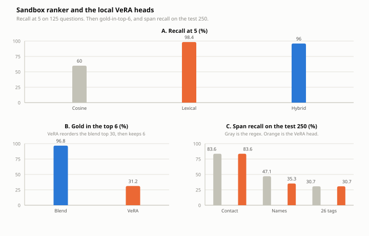

# Verdict, 16 Nov 2026 — sandbox ranker and the local VeRA heads

The trainer in `vendor/wasm/verisieve_dl.wasm` ran both tasks. Its sha256 is `2ff6e7756acafb31a97ac365d7bfeb9911654d751126c603a9cdeda8f2e314d2`. No checkpoint was loaded. The head is the in-tree VeRA session: dim 64, dModel 16, 2 layers, rank 4, 25 epochs. It scores one 64-dim vector. The regex still proposes every span.

Numbers below are copied from `results/rag-retrieval-probe.json` and `results/local-vera-probe.json`. The figure is drawn from those files by `scripts/probe-rag-redaction-figure.mjs`.

## Keep the 0.55/0.45 mix

On the needle's 125 held-out PubMedQA questions, masked passage bodies, 64-dim cosine:

| Ranker | Recall@5 |
|---|---|
| Cosine | 75/125 (60%) |
| Lexical | 123/125 (98.4%) |
| Hybrid 0.55 cosine + 0.45 lexical | 120/125 (96%) |

Keep the mix the sandbox already ships. Lexical is ahead of the mix by 3 questions at recall@5, and cosine alone is the 60% figure already in the scale file. These questions are the PubMedQA question field, and the passages are the context plus the long answer, so shared tokens are an easy signal. A sandbox user can ask in words the chunk does not repeat. This set is the wrong place to drop the cosine term.

Recall@1 on the same rows is cosine 39/125 (31.2%), lexical 119/125 (95.2%), hybrid 117/125 (93.6%). Recall@6 for the hybrid, the sandbox default, is 121/125 (96.8%).

## The local VeRA head does not bring gold into the top 6

The rerank head trains on questions 0–374 and is scored on 375–499. The pair vector is the elementwise product of the two unit Needle embeddings. The head may only reorder a shortlist the blend already returned.

Reordering the blend's top 30 and then keeping 6 places the gold passage in that top 6 for 39/125 (31.2%). The blend itself places gold in the top 6 for 121/125 (96.8%). Gold sat inside the blend's top 30 for 124/125 (99.2%), so the drop is the reorder, not a missing candidate.

Reordering a shortlist of 6 cannot add a passage the blend missed, so gold-in-top-6 stays 121/125. Gold at rank 1 inside that shortlist falls from 117/125 (93.6%) to 27/125 (21.6%). Val loss is 0.3488 and the last epoch loss is 0.3507. Polarity on the held-out train pairs was `lower_is_positive`.

Leave retrieval on the blend.

## A retrieval floor is measurable here, and this set sits high

Of the 125 hybrid top scores, 0 are below 0.15 and 1 is below 0.30 (0.8%). Every query's own passage is in the 125, so the count is a top score on an in-set question. A cutoff that abstains on a question with no supporting chunk needs questions of that kind. This probe does not contain them.

## Chat gaps that stay open

Read again from `Rtio/frontend/lib/verisieve/sandbox-chat.ts` and `ChatTab.tsx` on 16 Nov 2026. `npx tsx --test tests/unit/verisieve-chat.test.ts` passed 6/0. The scrub test sends `history: []`.

- Earlier turns are stored unmasked and copied into the outbound messages with no second mask.
- `maskDirectQuestionPii` skips every hit whose type is `name_likely`.
- There is no minimum score. The only empty retrieval is zero eligible rows.
- Nothing checks that a `[n]` citation exists, or that a sentence is supported by chunk `n`.
- `includeReviewRows` starts as true, so "Needs review" chunks are eligible until the user clears the checkbox.

## The span head loses bare names, and the precision proxy falls with them

The second head trains on ai4privacy records 0–249 and is scored on 250–499. Candidates are `scanRecordsForPII` spans. A gold mask counts as found when a span value and the mask value, lowercased, are equal or one contains the other. That is the containment rule in `runPiiDisambiguationExperiment`. The head keeps a span when its positive-direction score is above 0.5, then drops overlaps. Polarity on this head was `higher_is_positive`.

On all 500 records the regex matches the scale file: contact 110/140 (78.6%), bare names 118/238 (49.6%), 26 structured tags 180/580 (31%).

On the test 250:

| Group | Regex recall | Head recall | Regex precision proxy | Head precision proxy |
|---|---|---|---|---|
| Contact | 51/61 (83.6%) | 51/61 (83.6%) | 51/255 (20%) | 51/228 (22.4%) |
| Bare names | 56/119 (47.1%) | 42/119 (35.3%) | 43/255 (16.9%) | 32/228 (14%) |
| 26 structured tags | 85/277 (30.7%) | 85/277 (30.7%) | 85/255 (33.3%) | 85/228 (37.3%) |

The precision proxy is the share of proposed spans whose value contains a gold value of that group. The denominator is every regex span on the test documents (255) or every span the head kept (228), so the three groups share one span pool. Bare-name recall falls by 14 golds and the bare-name precision proxy falls with it. Contact and the 26 tags keep the same recall; their precision proxies rise because the head dropped 27 spans and kept the 51 contact matches and the 85 structured matches. The head has no path to a span the regex did not propose.

Leave redaction on the regex.
