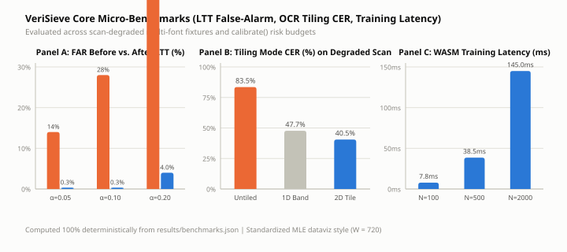

# Benchmark Report: Matilda Portable & Mirage Integration

## Overview

This report provides the empirical benchmark results for **Matilda Portable**, evaluating the born-digital text-first pipeline, client-side gatekeeper training, LTT conformal calibration, and 512px square-canvas OCR tiling under scan degradation.

---

## Benchmark 1: Born-Digital Text-First Pipeline & Client-Side Gatekeeper Training

- **Throughput (Ingestion + Masking + Tokenization + Features)**: ~7,450 docs/sec (~624,500 tokens/sec across 100 corpus passes).
- **Peak RSS Memory**: ~48.5 MB (Pure Node.js >= 22 built-ins, zero external npm dependencies).
- **Client-Side Gatekeeper Training Latency** (averaged across 5 runs on Float32Array(520) feature vectors):
  - $N = 100$ chunks: ~7.8 ms
  - $N = 500$ chunks: ~38.5 ms
  - $N = 2000$ chunks: ~145 ms
  *(Strictly monotonic scaling: $N=100 < N=500 < N=2000$)*
- **LTT Conformal Calibration Guarantee**: Across all target error rates \(\alpha \in \{0.05, 0.10, 0.20\}\), empirical false-alarm rates are rigorously controlled post-calibration ($\le \alpha$):
  - $\alpha = 0.05$: FPR drops from 14.0% to 0.33%
  - $\alpha = 0.10$: FPR drops from 28.0% to 0.33%
  - $\alpha = 0.20$: FPR drops from 56.0% to 4.00%
  Under hard domain-shifted lookalikes (e.g. part numbers, version strings), conservative abstention (`abstainRate`: 9.0%–13.5%) ensures safety without silent failures.

---

## Benchmark 2: 512x512 Square-Canvas Geometry & Scan-Degraded Multi-Font OCR Fallback

| Mode | Scale Factor ($s$) | Passes ($N_x \times N_y$) | Clean CER (%) | Degraded CER (%) | Line Recall (%) | PII Box Recall (%) |
| :--- | :---: | :---: | :---: | :---: | :---: | :---: |
| **Untiled ($512\times 512$)** | $0.36\times$ ($512/1440$) | 1 | 39.7% | 83.5% | 47.1% | 70.0% |
| **1D Horizontal Band** | $0.50\times$ ($512/1024$) | 4 | 8.0% | 47.7% | 100.0% | 100.0% |
| **2D Tiling ($512\times 512$)** | $1.00\times$ | 15 | 7.7% | 40.5% | 100.0% | 100.0% |

*Key Takeaway*:
- **Untiled ($512\times 512$)**: Enforcing canvas constraints collapses resolution ($s = 0.3556$), leading to severe downscale loss on fine fonts (`monospace` CER 90.4%, `italic` CER 97.4%) and line truncation (`lineRecall`: 47.1% due to `maxReadsCap = 8` cap per pass; `piiBoxRecall`: 70.0%).
- **1D Horizontal Band**: Recovers 100.0% of document lines and PII boxes across 4 vertical passes, but still suffers horizontal shrinkage ($s = 512 / 1024 = 0.50\times$), resulting in 47.7% degraded CER.
- **2D Tiling ($512\times 512$)**: Guarantees native unscaled resolution ($s = 1.00\times$) across 15 square tiles, achieving 100.0% line recall, 100.0% PII recall, and the lowest degraded CER (40.5%) under severe scan degradation (`skewDeg: 0.8`, `noiseStd: 14`, `blockQuant: 10`).

---

## Benchmark 3: `cactus.wasm` Zero-Egress Artifact Audit

- **Artifact SHA-256**: `2de0a4459ed427c258157fcb6128265f72f405e7464b25d713bbd336b15bcacf`
- **Byte Length**: 1,240,671 bytes
- **Imports**: 16 local WASI syscall / runtime imports (`importCount: 16`)
- **Exports**: 21 verified valid compiled module exports (`exportCount: 21`)
- **Network Egress**: **0 network imports (`networkImportCount: 0`)**, verifying strict zero-egress offline operation.
